<div align="center">

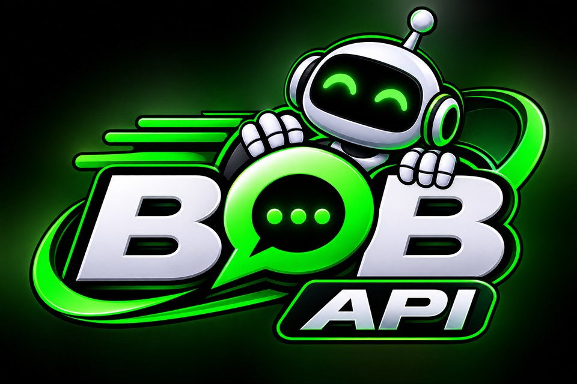

# API WhatsApp BOB

**API de WhatsApp livre, rápida e leve, com painel web próprio. Escrita em Go.**

[](https://github.com/Edton180/API-Whatsapp-BOB-/actions/workflows/ci.yml)


Desenvolvido por **Edton Braz** ([@Edton180](https://github.com/Edton180))

</div>

## O que é

A API WhatsApp BOB conecta números de WhatsApp a qualquer sistema (CRM, ERP, SaaS, lojas, automações) por uma
API HTTP simples. Ela tem motor próprio, construído sobre a biblioteca aberta
[whatsmeow](https://github.com/tulir/whatsmeow), painel web, webhooks, WebSocket e integrações nativas com
Chatwoot, Typebot e N8N. Não precisa de licença nem de ativação.

É o motor de WhatsApp do OmniFlow, mas funciona sozinha com qualquer sistema.

## Telas

| | |
|---|---|
| 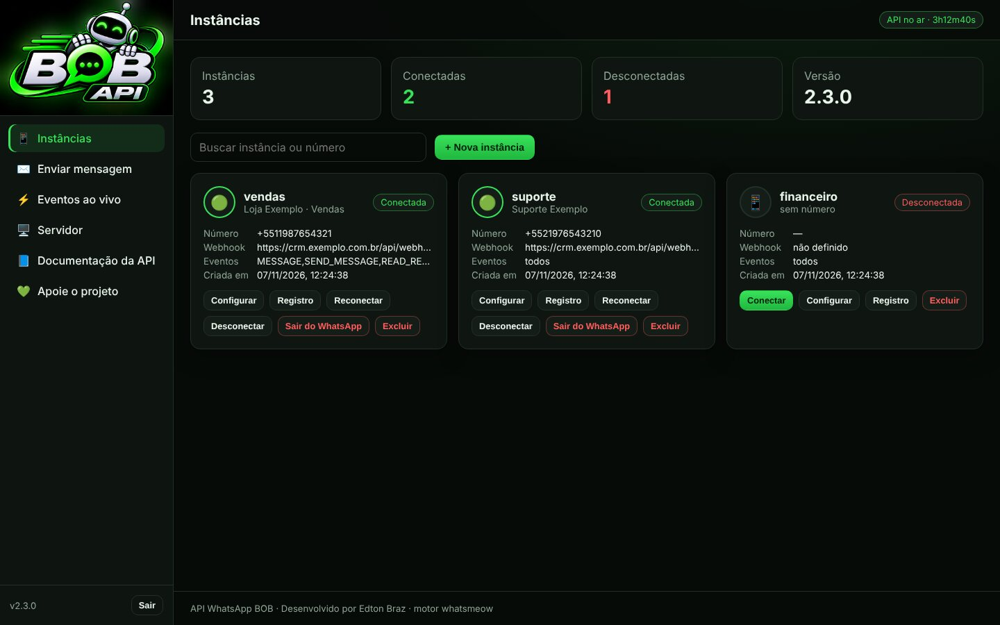 **Instâncias** | 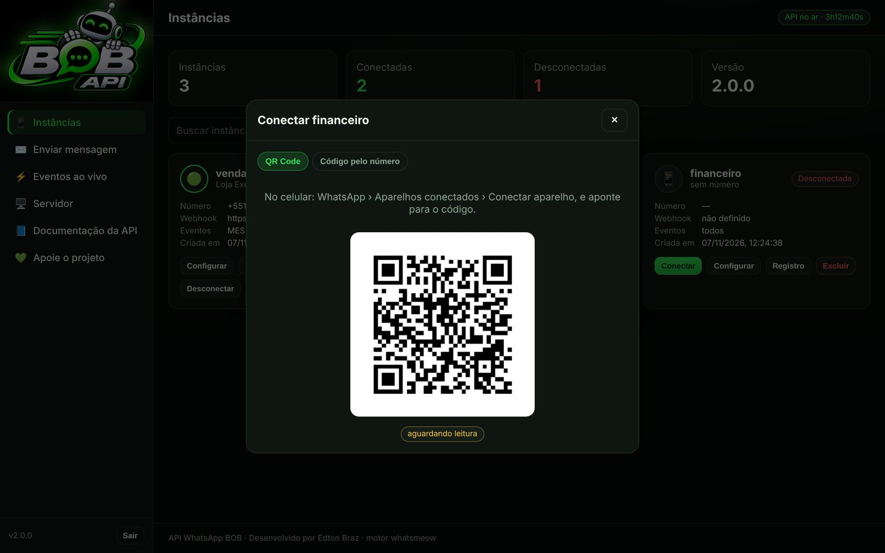 **Conectar por QR Code ou código** |
| 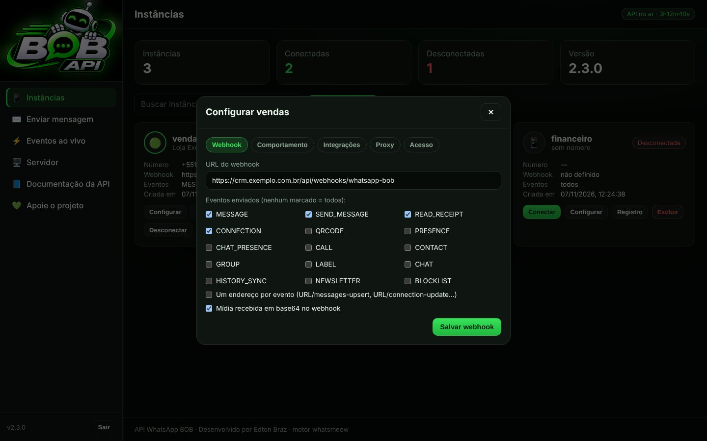 **Webhook e eventos** | 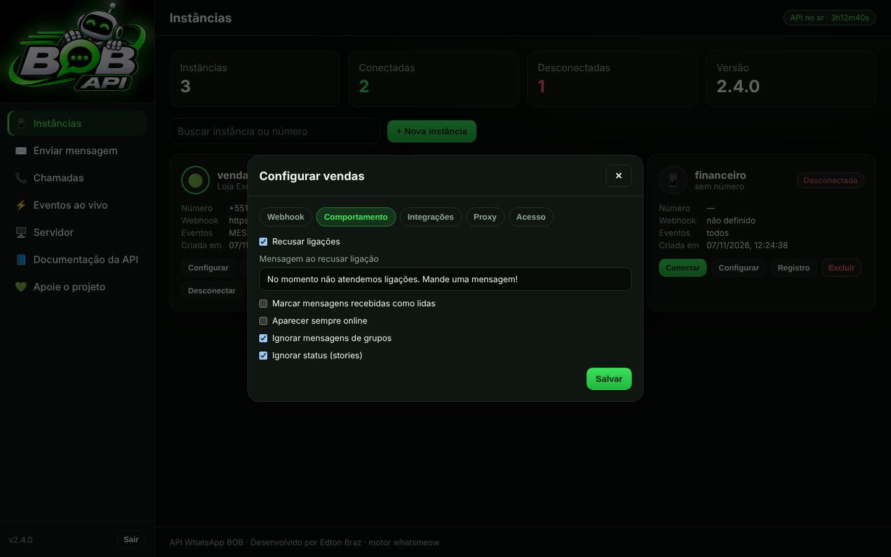 **Comportamento** |
| 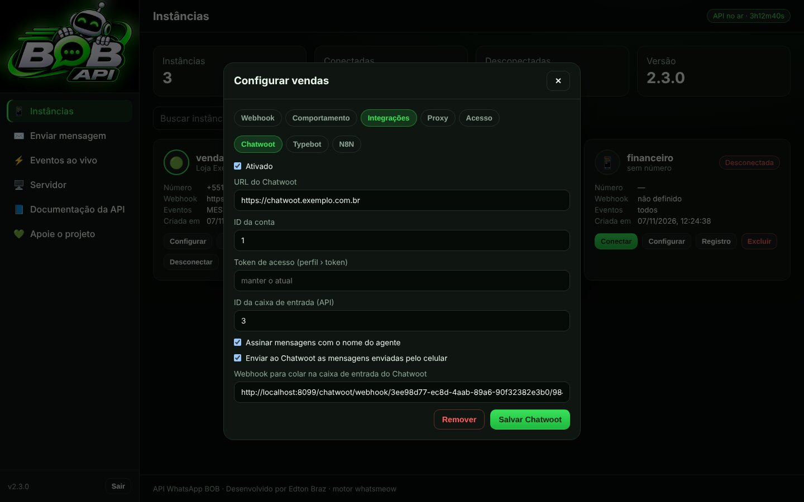 **Chatwoot, Typebot e N8N** | 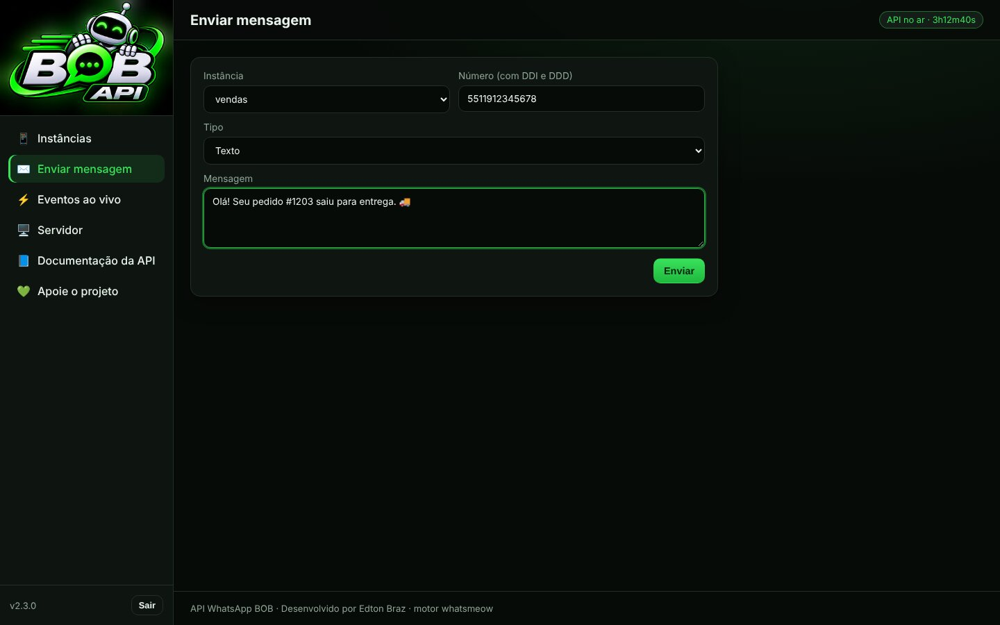 **Envio de teste** |
| 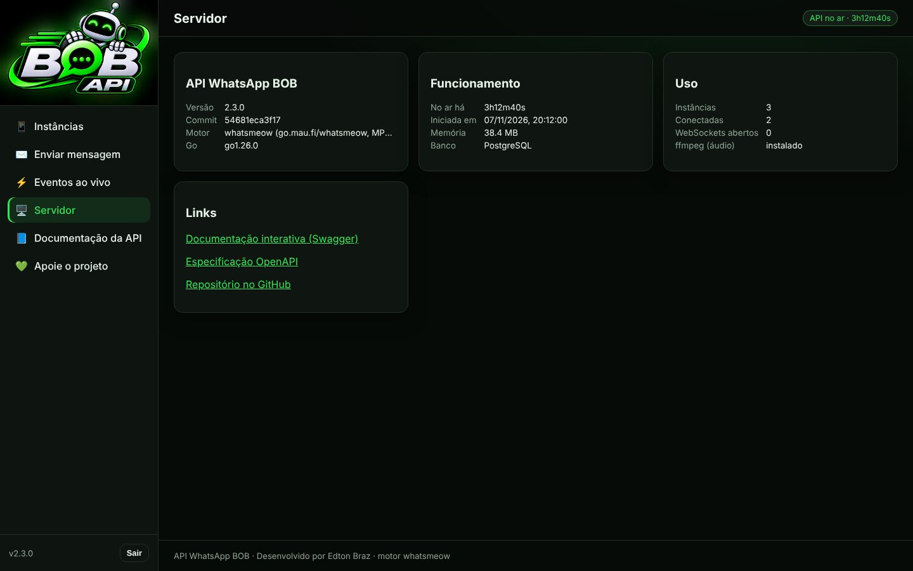 **Servidor** | 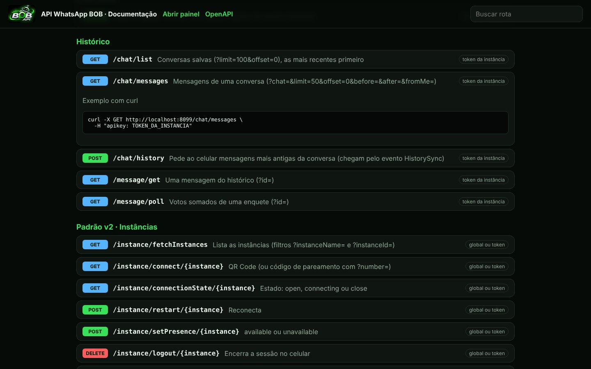 **Documentação da API** |
| 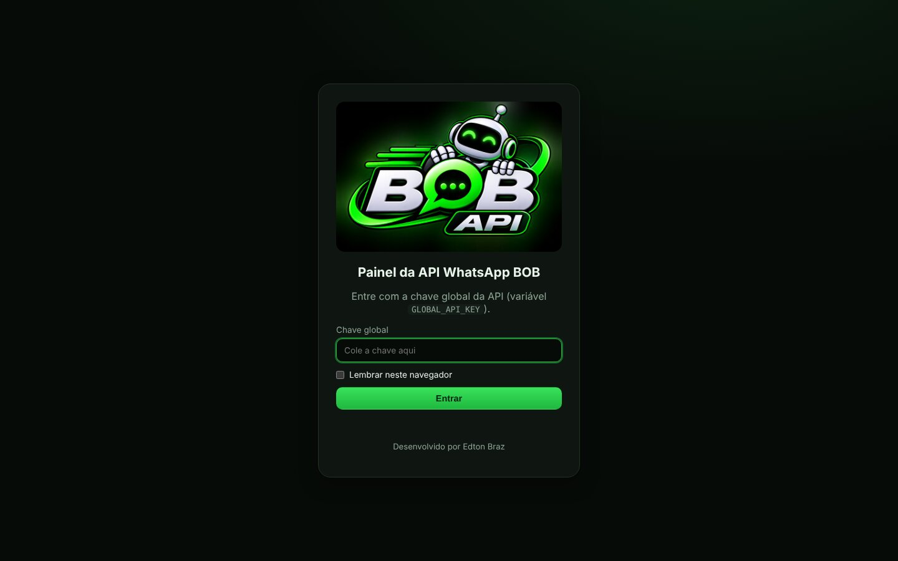 **Entrada** | 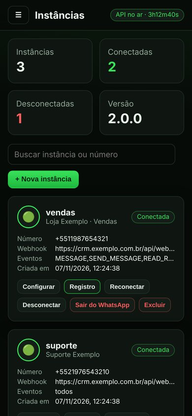 **No celular** |

As capturas foram feitas com dados de exemplo.

## Funções

| Grupo | O que faz |
|---|---|
| Instâncias | Vários números no mesmo servidor; criar, listar, conectar por **QR Code** ou **código de pareamento**, desconectar mantendo o login, reconectar, sair, excluir, proxy por número, registro de eventos |
| Envio | Texto (com resposta citada, menções e "digitando..."), link, imagem, vídeo, **áudio como nota de voz**, documento, **figurinha** (PNG/JPG/GIF/WebP viram WebP 512×512), localização, contato, enquete, **botões** (resposta, link, ligar, copiar, Pix), lista, status |
| Mensagens | Reagir, marcar como lida, apagar para todos, editar, presença, baixar mídia |
| Contatos | Verificar número (corrige o nono dígito), foto, recado, perfil comercial, agenda, bloquear, ler e alterar privacidade, nome, recado, foto do perfil (trocar e apagar), online/offline |
| Conversas | Arquivar, fixar, silenciar, marcar como lida ou não lida |
| Grupos | Listar, dados, criar, participantes, nome, descrição, foto, convite, ver convite sem entrar, entrar, sair, quem envia e quem edita, aprovação de entrada e pedidos, mensagens temporárias |
| Comunidades e canais | Criar comunidade e ligar grupos; criar canal, ver, seguir, silenciar e ler mensagens |
| Chamadas | Recusar ligação (automático ou pela API) |
| Etiquetas | Listar, etiquetar conversa ou mensagem, criar e editar (WhatsApp Business) |
| Eventos | Webhook com fila e novas tentativas, WebSocket, mídia recebida em base64 |
| Integrações | Chatwoot, Typebot e N8N nativos |
| Comportamento | Recusar ligações com mensagem, ler automaticamente, sempre online, ignorar grupos e status |

São mais de 160 rotas, todas em `/swagger/index.html` com exemplos prontos. Também responde no formato de rotas da Evolution API v2 (`/message/sendText/{instância}`...), veja [docs/padrao-v2.md](docs/padrao-v2.md).

## Instalação rápida

```bash
git clone https://github.com/Edton180/API-Whatsapp-BOB-.git api-whatsapp-bob
cd api-whatsapp-bob
cp .env.example .env                                   # defina GLOBAL_API_KEY
echo "POSTGRES_PASSWORD=$(openssl rand -hex 16)" >> .env
docker compose up -d --build
```

Abra `http://IP-DO-SERVIDOR:8080/painel/`, entre com a `GLOBAL_API_KEY`, crie uma instância e leia o QR Code.

Sem Docker, com SQLite e systemd, HTTPS com Nginx e todas as variáveis: [docs/instalacao.md](docs/instalacao.md).

## Primeiro envio

```bash
# 1. cria a instância (chave global)
curl -X POST http://localhost:8080/instance/create -H "apikey: CHAVE_GLOBAL" \
  -H "Content-Type: application/json" -d '{"name":"vendas"}'

# 2. conecta e lê o QR Code (token devolvido no passo 1)
curl -X POST http://localhost:8080/instance/connect -H "apikey: TOKEN" \
  -H "Content-Type: application/json" -d '{"webhookUrl":"https://seu-sistema/webhook","subscribe":["MESSAGE","CONNECTION"]}'
curl http://localhost:8080/instance/qr -H "apikey: TOKEN"

# 3. envia
curl -X POST http://localhost:8080/send/text -H "apikey: TOKEN" \
  -H "Content-Type: application/json" -d '{"number":"5511999998888","text":"Olá! 👋"}'
```

## Documentação

| Documento | Assunto |
|---|---|
| [docs/instalacao.md](docs/instalacao.md) | Docker, sem Docker, OmniFlow, HTTPS, variáveis e backup |
| [docs/painel.md](docs/painel.md) | Telas do painel |
| [docs/eventos.md](docs/eventos.md) | Webhook, categorias de eventos e WebSocket |
| [docs/integracoes.md](docs/integracoes.md) | Chatwoot, Typebot e N8N |
| [docs/padrao-v2.md](docs/padrao-v2.md) | Rotas `/message/sendText/{instância}`... para sistemas feitos no padrão Evolution API v2 |
| [docs/atualizacao.md](docs/atualizacao.md) | Atualizar sem perder números conectados |
| `/swagger/index.html` | Todas as rotas, com exemplos (também em `/openapi.yaml`) |
| [CHANGELOG.md](CHANGELOG.md) | Histórico de versões |

## Estrutura

```
cmd/bob/              início do servidor
internal/engine/      motor: sessões do WhatsApp, eventos, envios e ações
internal/api/         rotas HTTP
internal/events/      webhook e WebSocket
internal/integrations Chatwoot, Typebot e N8N
internal/panel/       painel web e documentação (embutidos no programa)
internal/store/       banco (PostgreSQL ou SQLite)
internal/media/       figurinhas, áudio, miniaturas
```

## Contribua

A BOB é livre e aberta. Correções, novas funções e documentação são bem-vindas: leia o
[CONTRIBUTING.md](CONTRIBUTING.md), abra uma issue ou envie um pull request.

## Apoie o projeto (Pix)


Abra o app do seu banco, escolha **Pix › Ler QR Code** ou **Pix Copia e Cola** e digite o valor que quiser.

- **Favorecido:** Edton Kaik Braz Da Conceição
- **Chave Pix (CPF):** 04646947285
- **Pix Copia e Cola:** também na tela **Apoie o projeto** do painel e em `GET /donate/pix`.

## Licença

[Apache License 2.0](LICENSE). Componentes de terceiros e créditos em [NOTICE](NOTICE). "WhatsApp" é marca da
Meta Platforms, Inc.; a BOB não é afiliada à Meta.

---

<div align="center">Desenvolvido por <strong>Edton Braz</strong></div>
